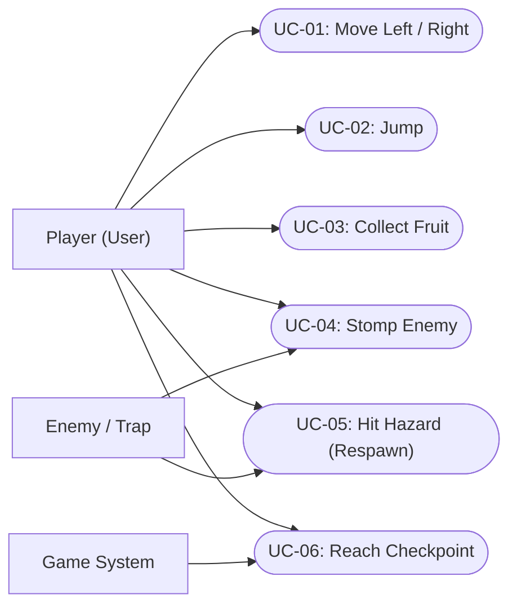
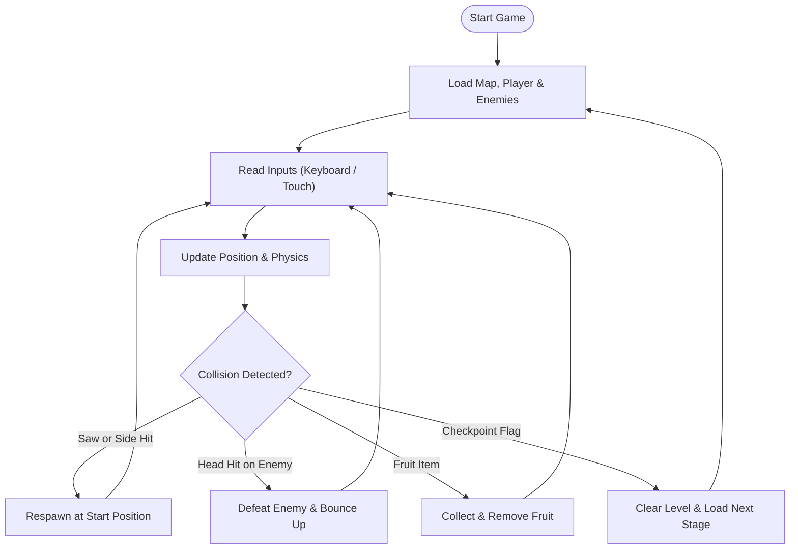

# Project Game Design Document (Lean Indie GDD)
## Pixel Adventure — 2D Pixel-Art Platformer

**Student / Author:** Ahmed Amin Al-Hindwan  
**Supervisor / Instructor:** Salem Al-Soumhi  
**Engine & Framework:** Flutter with Flame Engine  
**Viewport:** 640 × 360 px (Landscape)  
**Version:** 1.0.0  

---

## 1. Introduction

### 1.1 Project Overview
**Pixel Adventure** is a modular 2D indie platformer game developed in **Flutter** using the **Flame** engine. It combines classic retro pixel-art visuals with smooth physics, animated characters, moving hazards, and dynamic tile-based levels.

### 1.2 Core Concept
The player controls an agile hero (*Mask Dude*) navigating platforms, avoiding circular saws, collecting scattered fruits, and jumping on patrol enemies. The primary goal is to reach the checkpoint flag to clear the stage and advance to the next level.

### 1.3 Core Gameplay Loop
1. **Spawn:** Player spawns at the starting point of the level.
2. **Platforming:** Run and jump across solid ground and one-way platforms.
3. **Interact & Survive:** 
   - Collect fruit items for score and audio feedback.
   - Avoid touching moving saws and enemy flanks (which causes an immediate respawn).
   - Stomp on enemies from above to eliminate them and bounce upward.
4. **Level Complete:** Touch the checkpoint to raise the flag and advance to the next level.

---

## 2. Objectives

### 2.1 Technical Objectives
* **Component-Based Architecture:** All game entities (Player, Enemies, Hazards, Items) are built as clean, modular Flame components.
* **Responsive 2D Physics:** Smooth gravity, jump impulses, and solid platform collision checks.
* **Data-Driven Levels:** Automatically loads terrain, spawn points, and obstacles from TMX map files created in Tiled.
* **Dual Controls:** Seamless support for keyboard controls on PC and on-screen touch controls (Virtual Joystick & Jump Button) on mobile.
* **Audio Feedback:** Non-blocking sound effects for jumps, pickups, damage hits, and level clears.

### 2.2 Player Objectives
* **Win Condition:** Safely reach the checkpoint flag at the end of the map.
* **Collection:** Gather all fruits scattered throughout the stage.
* **Survival:** Navigate past moving saw blades without getting hit.
* **Combat:** Eliminate patrol chickens by jumping directly onto their heads.
* **Respawn Rule:** Taking damage resets the player to the beginning of the level immediately.

---

## 3. Use Cases

### 3.1 Use Case Table

| ID | Use Case | Actor | Main Flow / Description |
| :--- | :--- | :--- | :--- |
| **UC-01** | Move Horizontally | Player | Press Left/Right or tilt Joystick $\rightarrow$ Character moves left/right and flips sprite facing. |
| **UC-02** | Jump | Player | Press Space or tap Jump Button $\rightarrow$ Character jumps with sound effect. |
| **UC-03** | Collect Fruit | Player | Touch fruit $\rightarrow$ Play pickup sound, display burst animation, remove item. |
| **UC-04** | Stomp Enemy | Player | Land on Chicken from above $\rightarrow$ Enemy is defeated and player bounces upward. |
| **UC-05** | Hit Hazard / Respawn | Player | Touch Saw or enemy flank $\rightarrow$ Play hit sound and respawn at starting position. |
| **UC-06** | Reach Checkpoint | Player | Touch Checkpoint $\rightarrow$ Flag raises, exit animation plays, next level loads. |

### 3.2 Use Case Diagram



---

## 4. Game Logic Flowchart



---

## 5. User Interfaces (UI/UX)

### 5.1 In-Game Viewport & Controls
* **Game Viewport:** Fixed 640 × 360 pixel landscape camera with a scrolling background.
* **Virtual Joystick (Bottom-Left):** On-screen stick to move the character left and right on touch devices.
* **Jump Button (Bottom-Right):** On-screen button for jumping on touch devices.

### 5.2 Gameplay Screenshots Placeholders
*Insert your actual game screenshots below:*

#### A. Main Gameplay Screen (Level-01 Platforming)
```markdown

```

#### B. Virtual Touch Controls (Joystick & Jump Button)
```markdown

```

#### C. Checkpoint Goal Reached (Level Clear)
```markdown

```

#### D. Enemy Interaction (Jump Stomp Bounce)
```markdown

```

### 5.3 Available Menu Assets in Project
The repository contains ready-to-use pixel-art button assets in `assets/images/Menu/`:
* **Play Button:** For starting the game from a main menu.
* **Settings & Volume Buttons:** For sound options and adjustments.
* **Restart & Back Buttons:** For in-game pause and retry menus.
* **Level Badges (01 to 50):** For a future stage selection screen.

---

## 6. Future Enhancements

1. **Save System:** Save high scores, collected fruits, and unlocked levels locally on the device.
2. **Add More Levels:** Connect `Level-02.tmx` (already present in the assets folder) into the game loop.
3. **Main Menu & Pause Screen:** Build a clean start screen and pause overlay using the available button sprites.
4. **More Enemies and Traps:** Add other enemy types (like *Angry Pig* and *Bat*) and hazards (like *Spikes*) already available in the sprites folder.
5. **Health / Lives System:** Give the player 3 hearts so taking damage reduces a heart instead of infinite respawns.
6. **Background Music (BGM):** Add looping background music tracks to accompany the existing sound effects.
